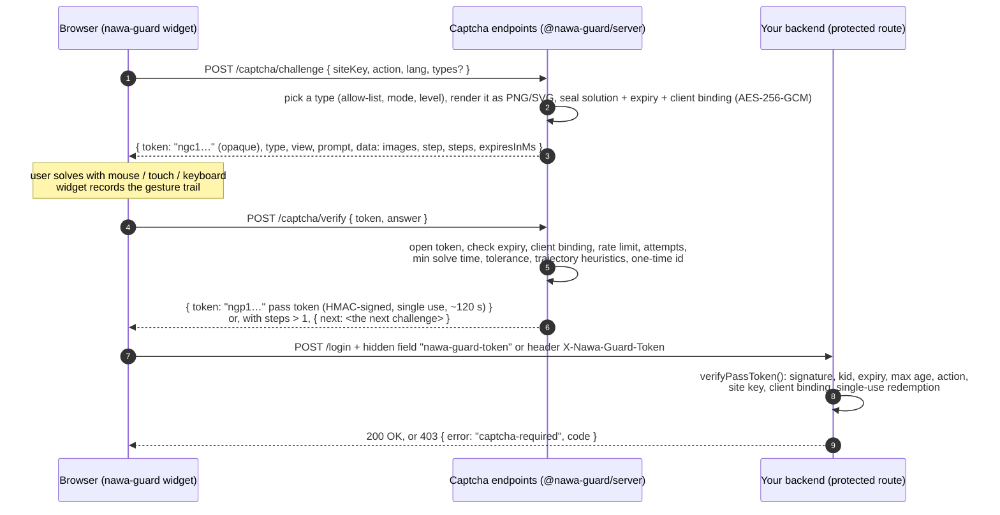

# Nawa Guard

[](https://github.com/oriebalzyuot96/nawa-guard/actions/workflows/ci.yml) [](LICENSE)

**Self-hosted, accessible puzzle CAPTCHA with 30+ puzzle types, an audio challenge, six themes and a premium 3D design — an open-source reCAPTCHA / hCaptcha / Turnstile alternative for React, Vue, Svelte, Angular and plain HTML, with Node.js and ASP.NET Core verification.**

🌐 [Website](https://oriebalzyuot96.github.io/nawa-guard/) · 🧩 [Live playground](https://oriebalzyuot96.github.io/nawa-guard/#playground) (runs in your browser) · ⚡ [Open the Node demo in StackBlitz](https://stackblitz.com/github/oriebalzyuot96/nawa-guard)

```bash
npm i @nawa-guard/server @nawa-guard/widget    # or: yarn add / pnpm add
```

> **Coming to npm.** The packages will be published under the `@nawa-guard` scope (and `NawaGuard.AspNetCore` on NuGet) once the organisation exists; `npm view @nawa-guard/server` does not find them yet. Until then, build from source: `git clone https://github.com/oriebalzyuot96/nawa-guard.git && cd nawa-guard && npm install && npm run build`, then `npm pack -w @nawa-guard/server -w @nawa-guard/widget` and install the `.tgz` files (or use a workspace / `file:` dependency).

**Nawa Guard** is an open-source, privacy-friendly puzzle CAPTCHA from the Nawa family (a separate project from the Nawa UI component library). It's designed around three ideas:

1. **The client is never trusted.** Puzzles are rendered on the server as pixels. The solution is sealed inside the challenge token with AES-256-GCM and never reaches the browser in a form it can read.
2. **Verification happens on your own backend, the way reCAPTCHA's siteverify does.** A solved puzzle produces a short-lived, single-use, HMAC-signed **pass token**. Your protected route verifies it locally with no third-party call. Node and ASP.NET Core implementations are included and interoperate.
3. **Everyone can pass it.** Every puzzle works with mouse, touch and keyboard. A text question and an audio challenge work with screen readers (WCAG 1.1.1 and 2.1.1). Arabic and English are built in, with full RTL support.

It also looks the part: a layered, glass-like card with depth and subtle motion, six theme presets (light and dark) plus high contrast, automatic pick-up of your Orca UI tokens, and optional synthesized sound effects. See [Design, themes and sound](#design-themes-and-sound).

| Package | What it is |
|---|---|
| [`@nawa-guard/server`](packages/server) | Node ≥ 18 core with zero runtime dependencies (only `node:crypto` and `node:zlib`). Handles challenges, verification, pass tokens, stores, HTTP and Express adapters. |
| [`@nawa-guard/widget`](packages/widget) | `<nawa-guard>` Web Component: Shadow DOM, no dependencies, works under a strict CSP. |
| [`@nawa-guard/react`](packages/react) | `<NawaGuard>` component plus a `useNawaGuard()` hook (React 18/19). |
| [`@nawa-guard/vue`](packages/vue) | Vue 3 component with `v-model` support. |
| [`@nawa-guard/svelte`](packages/svelte) | Svelte 5 component with a bindable `token`. |
| [`@nawa-guard/angular`](packages/angular) | Standalone component that is also a `ControlValueAccessor` and `Validator`, for reactive forms. |
| [`dotnet/`](dotnet) `NawaGuard.AspNetCore` | .NET 8 package with `INawaGuardVerifier`, `[RequireNawaGuard]`, `.RequireNawaGuard()` and `AddNawaGuard()`. |
| [`demo/`](demo) | Express demo with every puzzle type, a protected form and a protected JSON API. |

## Puzzle types

38 challenge types, each in its own module under [`packages/server/src/puzzles`](packages/server/src/puzzles) with tests. Every type renders as pixels (PNG), path-only SVG or synthesized audio (WAV) on the server; the answer stays in the sealed token. Each works with mouse, touch **and** keyboard, and the accessible alternatives (`accessible` text question, `audio` challenge) are always one click away. Try them all in the [playground](https://oriebalzyuot96.github.io/nawa-guard/#playground).

"Blind guess" is the chance that a random answer (with a fake but plausible gesture) passes a single attempt. Types with a high blind-guess rate are fine as friction on low-risk forms, or combined with others via `steps`; don't rely on them alone for sensitive actions.

**Drag, slide, rotate, hold** (answer is continuous; pointer trails are checked by the heuristics)

| Type | What the user does | Keyboard | Rule | Blind guess |
|---|---|---|---|---|
| `slider` | Drags a puzzle piece into its gap. Piece outlines vary: jigsaw tab, jigsaw notch, circle, star, shield, heart, hexagon. Level ≥ 1 adds a decoy hole. | Slider thumb: arrows (Shift = ×5), Enter | ±6 px (±5 at level ≥ 2), trail must match | ≈ 8% |
| `slide-unlock` | Slides a handle until its arrow points at a ring placed at a random spot among decoy outlines. | as `slider` | ±6 px | ≈ 7% |
| `shadow-drag` | Drags a coloured pictogram onto the silhouette with the same outline (3–4 shadows). | Piece: arrows move it (Shift = ×4), Enter drops | within 13 px (10 at level ≥ 2) | < 2% |
| `jigsaw` | Swaps four picture quarters until the scene is whole. | Arrow keys between pieces, Space selects / swaps | exact order | 1 in 23 |
| `rotate` | Rotates an outdoor scene (sky, ground, house, tree) upright. | Slider thumb: arrows (3°, Shift = 15°) | ±12° (±9° at level ≥ 2), wrap-around | ≈ 8% |
| `rotate-object` | Rotates one object (house, tree, bell, cup, umbrella, flag, apple, car) upright. | as `rotate` | as `rotate` | ≈ 8% |
| `rotate-match` | Turns an inner disc until the picture lines up with the fixed outer ring. | as `rotate` | as `rotate` | ≈ 8% |
| `hold` | Presses and holds, releasing while the sweeping ring is in a green zone drawn at a random position. | Hold Space, **or** Enter to start and Enter to stop | zone ± 70 ms; the server must have seen at least the claimed hold time | ≈ 1 in 4 |

**Select in a picture** (one PNG with a cell grid; answer is a cell set)

| Type | What the user does | Rule | Blind guess |
|---|---|---|---|
| `icons` | Selects every named geometric shape in a 3×3 grid. | exact set | < 1% |
| `icons-weather` | Same, with weather pictograms (sun, cloud, raindrop, lightning, snowflake, umbrella, moon, star). | exact set | < 1% |
| `icons-objects` | Same, with everyday objects (key, cup, bell, leaf, fish, house, tree, car, flag, apple). | exact set | < 1% |
| `odd-one-out` | Selects the one picture that differs (colours, sizes and angles never give it away). 4×4 at level ≥ 2. | one cell | 1 in 9 (1 in 16) |
| `odd-rotation` | Finds the mirrored ("backwards") letter among rotated copies. | one cell | 1 in 6 (1 in 9) |
| `color-name` | Selects every swatch of a named colour. Each colour also carries its own pattern (dots, stripes, cross, ring, zigzag), named in the prompt, so it does not rely on colour vision (WCAG 1.4.1). | exact set | < 1% |
| `biggest` | Selects the largest (or smallest) of nine copies of a pictogram. | one cell | 1 in 9 |
| `find-shape` | Selects every cell showing the shape in the reference box (no words needed). | exact set | < 1% |
| `shadow-pick` | Selects the silhouette matching the coloured picture. | one cell | 1 in 6 |
| `pattern` | Picks what comes next in a row (AB, ABC, AAB or a quarter turn per step). | one cell | 1 in 6 |
| `clock` | Selects the analogue clock that shows the time in the prompt (decoys are the usual misreadings). | one cell | 1 in 6 |
| `math-compare` | Selects every card whose sum or difference is more than N (drawn as strokes). | exact set | 1 in 62 |
| `symmetry` | Fills the right half of a pixel picture so it mirrors the given left half. | exact set | < 0.1% |
| `pairs` | Links the eight (twelve) pictures into matching pairs. | exact pairing | 1 in 105 |

**Tap in order**, **put in order**, **draw a path**

| Type | What the user does | Keyboard | Blind guess |
|---|---|---|---|
| `tap-order` | Taps 4–5 numbers from smallest to largest. | Crosshair: arrows, Space taps, Backspace undoes | < 0.1% |
| `spell` | Taps letters to spell the word shown at the top (decoy letters mixed in; all drawn as strokes). | as `tap-order` | < 0.1% |
| `order` | Orders tiles by dot count or bar height. | Space picks up, arrows move (RTL-aware), Space drops | 1 in 24 (1 in 120) |
| `order-size` | Orders one pictogram at clearly different sizes. | as `order` | 1 in 24 |
| `order-numbers` | Orders numbers (drawn as strokes) ascending or descending. | as `order` | 1 in 24 |
| `order-time` | Orders analogue clocks from earliest to latest. | as `order` | 1 in 24 |
| `story` | Puts a short picture story in order: seed → flower, candle burning down, glass filling, egg hatching, battery charging. | as `order` | 1 in 6 – 1 in 24 |
| `trace` | Connects numbered dots in order (decoys present). | Crosshair: arrows, Space adds a point | < 0.1% |
| `trace-letters` | Connects dots labelled A, B, C… in alphabetical order. | as `trace` | < 0.1% |
| `maze` | Draws a path from the start dot to the flag without crossing walls. | Arrows move one cell; Space starts drawing, Backspace undoes, Enter submits | < 0.1% |

**Type the answer**, **invisible**, **text alternative**

| Type | What the user does | Blind guess |
|---|---|---|
| `math` | Types the result of a sum drawn as a noisy SVG of jittered stroke glyphs (no `<text>`). Arabic-Indic digits accepted. | ≈ 10% (OCR-able: low assurance) |
| `count` | Types how many of a named pictogram are in a busy picture. | ≈ 1 in 5 |
| `dice` | Types the total of two (three) rotated dice. | ≈ 1 in 6 |
| `pow` | Nothing: an invisible hashcash proof of work, SHA-256(`salt:nonce`) with `bits` leading zero bits. Default 16 bits, +2 per level; per-action `powBits`. | n/a (proves CPU, not humanity) |
| `accessible` | Answers a plain-text question in Arabic or English: 50+ randomised templates (numbers, days, months, seasons, colours, categories, opposites, comparisons, letters…). Answers are normalised (case, diacritics, alef/ta-marbuta variants, Arabic-Indic digits, words or digits, either language) and carry a silent PoW tax. | machine-readable by design |
| `audio` | Presses Play and types what they heard: 4–5 English digits spoken by a randomised formant voice (`lang="en"`), or the number of high-pitched beeps in a run of high and low ones (`lang="ar"`, language-neutral). Rain-like noise and muffled babble are mixed in; replays are limited; there is no transcript. Silent PoW tax, like `accessible`. See [Audio challenge](#audio-challenge). | 1 in 10,000 (digits) · ≈ 1 in 6 (beeps) |

Per type you can override `maxAttempts` and `minSolveMs`. `assessRisk()` and failed attempts raise the difficulty level, which tightens tolerances, adds decoys, tiles and PoW bits.

---

## Choosing puzzles (one, two or many)

The server decides; the browser can only narrow its choice.

```ts
const guard = createNawaGuard({
  secret: process.env.NAWA_GUARD_SECRET,
  types: ['slider', 'rotate-object', 'pairs', 'maze', 'pow'],  // allow-list (default: all)
  weights: { maze: 2, pow: 0 },                                // random weights; 0 disables
  mode: 'random',                                              // 'random' | 'sequence' | 'adaptive' (default)
  steps: 1,                                                    // puzzles in a row before a pass token (1-3)
  perAction: {
    login: ['pow', 'slider'],                                  // shorthand: just the types
    signup: { types: ['maze', 'pairs', 'spell'], steps: 2 },   // two different puzzles in a row
    reset: { types: ['accessible', 'slider'], mode: 'sequence', powBits: 20 },
  },
  // clientNarrowing: true,   // honour <nawa-guard types="…"> (never widens; default true)
  // allowAccessible: true,   // the text alternative can always be requested (default true)
});
```

- **`types`** is the allow-list. Unknown names throw at startup. Without it, `adaptive` uses all types (filtered by the ladder) and `random`/`sequence` use every visual type.
- **`mode`**: `adaptive` walks the difficulty ladder (`ladder[level] ∩ types`, falling back to the nearest rung that has an allowed type); `random` is a weighted pick; `sequence` rotates through the allowed types per client and action.
- **`perAction`** overrides `types`, `weights`, `mode`, `steps`, `ladder` and `powBits` for one action.
- **`steps: 2 | 3`** chains puzzles: `POST /verify` answers `{ success: true, next: <challenge> }` until the last step, each step uses a different type when the pool allows it, and only then returns a pass token. The pass token lists every solved type in `stp` (see the token format). The widget shows "Step 1 of 2" and moves on automatically.
- **The accessible alternatives** stay reachable from every widget (`type: 'accessible'` and `type: 'audio'`) unless you set `allowAccessible: false`. They are never drawn at random.

In the browser, narrow the server's list with `types` (comma-separated). If none of the requested types is allowed, the server's own list is used:

```html
<nawa-guard site-key="main" endpoint="/captcha" action="login" types="slider,rotate-object"></nawa-guard>
```

The wrappers take a `types` prop (string or array): `<NawaGuard types={['slider', 'pairs']} />` (React), `:types="['slider']"` (Vue), `types={['slider']}` (Svelte), `[types]="['slider']"` (Angular).

On the verifying side, restrict what a route accepts:

```js
await verifyPassToken(token, { secret, expectedAction: 'checkout', allowedTypes: ['slider', 'maze', 'pairs'], minSteps: 2, client });
```

```csharp
// appsettings: "NawaGuard": { "AllowedTypes": ["slider", "maze"], "ActionAllowedTypes": { "login": ["pow", "slider"] }, "MinSteps": 1 }
app.MapPost("/pay", Pay).RequireNawaGuard("checkout", new NawaGuardRequirements(AllowedTypes: ["slider", "maze"], MinSteps: 2));
[HttpPost("signup"), RequireNawaGuard("signup", AllowedTypes = new[] { "maze", "pairs" }, MinSteps = 2)]
```

For a multi-step token, `allowedTypes` passes when **at least one** solved step is allowed (so `['pow', 'slider']` passes a route that excludes `pow`); `minSteps` counts the solved steps. A token for the wrong count fails with `too-few-steps`.

---

## Live demo and demo mode

- **[Playground](https://oriebalzyuot96.github.io/nawa-guard/#playground)** on the static site: pick any type, mix several and watch `random` / `sequence` / `adaptive` and multi-step behaviour, switch Arabic/English (RTL) and light/dark (Nawa UI tokens), and read the decoded pass token and the sealed claims.
- **[StackBlitz](https://stackblitz.com/github/oriebalzyuot96/nawa-guard)** runs the real Node demo server (`.stackblitzrc` starts `npm run demo`): a protected form, a two-step checkout, a protected JSON API and a gallery of every type.

GitHub Pages has no server, so the site runs in **demo mode**: [`scripts/build-site.mjs`](scripts/build-site.mjs) bundles the real `@nawa-guard/server` engine with esbuild, swapping the Node platform layer ([`primitives.ts`](packages/server/src/primitives.ts): `node:crypto`, `node:zlib`) for [`primitives.browser.ts`](packages/server/src/primitives.browser.ts) (`crypto.getRandomValues`, small SHA-256/HMAC/HKDF/AES-256-GCM implementations tested byte-for-byte against Node, and stored-block deflate for PNGs). An in-page endpoint shim ([`site/src/demo-endpoint.ts`](site/src/demo-endpoint.ts)) answers the widget's `fetch()` calls. Limits, by design:

- The secret is generated in the page, so anyone can read the sealed solutions there (the playground even shows them). Demo mode is for learning and trying puzzles, never for protecting anything.
- PNGs are stored uncompressed (larger data URLs); generation runs on the main thread (tens of ms per puzzle).
- No rate limits across tabs, no real client IP (a fixed demo IP plus your User-Agent).

The `browser` field of `@nawa-guard/server` maps the platform layer for bundlers too, so the engine also runs in workers or edge runtimes; in production it belongs on a server that keeps the secret.

---

## How it works



The captcha endpoints and the protected route can be the same Node app (as in the demo) or different services that share the secret, for example a Node sidecar plus an ASP.NET Core API.

---

## Quick start (Node + Express)

```bash
npm install @nawa-guard/server @nawa-guard/widget express
```

```js
import express from 'express';
import { createNawaGuard } from '@nawa-guard/server';
import { nawaGuardExpress, requireCaptcha } from '@nawa-guard/server/express';

const guard = createNawaGuard({
  secret: process.env.NAWA_GUARD_SECRET, // ≥ 32 chars, from your secret store; never sent to browsers
  siteKeys: ['main'],                     // public identifiers the widget may use
  actions: ['login', 'signup', 'contact'],
});

const app = express();
app.set('trust proxy', 1); // only if you are behind a reverse proxy, so req.ip is the browser's IP

// 1) Challenge + verify endpoints → POST /captcha/challenge, POST /captcha/verify
app.use('/captcha', express.json({ limit: '32kb' }), nawaGuardExpress(guard));

// 2) Protect routes. The token comes from the X-Nawa-Guard-Token header or the nawa-guard-token field.
app.post('/login',
  express.urlencoded({ extended: false }),
  requireCaptcha(guard, { expectedAction: 'login', maxAgeSec: 300 }),
  (req, res) => res.send(`ok, solved with ${req.nawaGuard.typ}`));
```

Generate a secret once with `node -e "console.log(require('crypto').randomBytes(32).toString('base64url'))"`.

---

## Frontend integration

### Plain HTML / any framework (Web Component)

```html
<script type="module">import '@nawa-guard/widget';</script>

<form method="post" action="/login">
  <input name="email" type="email" required>
  <nawa-guard site-key="main" endpoint="/captcha" action="login" lang="ar"></nawa-guard>
  <button>Sign in</button>
</form>
```

| Attribute | Default | Meaning |
|---|---|---|
| `site-key` | `default` | Public site key. Never the secret. |
| `endpoint` | `/captcha` | Base URL of the two endpoints. |
| `action` | `default` | Action name. The backend must expect the same action. |
| `lang` | inherited `lang`, else `en` | `ar` or `en`. Arabic switches the widget to RTL. |
| `name` | `nawa-guard-token` | Name of the hidden `<input>` (in light DOM) that is submitted with the form. |
| `types` | (server decides) | Comma-separated types to **narrow** the server's allow-list, e.g. `slider,rotate`. Never widens it; ignored if none of them is allowed. |
| `type` | (server decides) | One exact puzzle. Only honoured with `allowClientType: true` (galleries), except `accessible` and `audio`, which are always allowed. |
| `dir` | from `lang` | Forces `rtl` or `ltr`. |
| `theme` | `auto` | `orca`, `midnight`, `aurora`, `sand`, `ocean`, `mono`, or `auto` (page tokens, else Orca). Shorthands `light`, `dark`, `high-contrast` set the appearance. See [Themes](#themes). |
| `appearance` | `auto` | `light`, `dark`, `high-contrast`, or `auto` (follows `prefers-color-scheme` and `prefers-contrast`). |
| `sound` | off | Turns UI sound effects on by default (`sound`, `sound="on"`; `sound="off"` to force the default off). The visitor's speaker toggle still wins. |
| `volume` | `0.6` | UI sound volume, `0`–`1`. |
| `muted` | – | Silences the widget whatever the visitor chose (your app's own mute). |
| `tilt` | on | `tilt="off"` disables the pointer-following tilt (it is already off for touch, reduced motion and high contrast). |

Events, all `bubbles` + `composed`:
- `nawa-guard:verified` with `detail: { token, expiresInMs, type }` (after the last step of a multi-step chain)
- `nawa-guard:expired` (the pass token lapsed and a new challenge loads)
- `nawa-guard:error` with `detail: { error: 'network' | 'rate-limited' | 'config' }`

API: `el.token` (`''` until verified) and `el.reset()`. Call `reset()` after you use a token, because tokens are single-use. Properties `theme`, `sound`, `volume` and `muted` mirror the attributes; `setNawaGuardMuted(true)` (exported by `@nawa-guard/widget`) mutes every widget on the page.

```js
const guard = document.querySelector('nawa-guard');
guard.addEventListener('nawa-guard:verified', (e) => submitBtn.disabled = false);
await fetch('/api/contact', { method: 'POST', headers: { 'X-Nawa-Guard-Token': guard.token, 'Content-Type': 'application/json' }, body });
guard.reset();
```

### React

```tsx
import { NawaGuard, useNawaGuard } from '@nawa-guard/react';

export function LoginForm() {
  const guard = useNawaGuard();
  async function onSubmit(e: React.FormEvent) {
    e.preventDefault();
    await fetch('/api/login', { method: 'POST', headers: { 'X-Nawa-Guard-Token': guard.token } });
    guard.reset(); // single-use
  }
  return (
    <form onSubmit={onSubmit}>
      <NawaGuard siteKey="main" action="login" lang="ar" {...guard.bind} />
      <button disabled={!guard.verified}>Sign in</button>
    </form>
  );
}
```

`<NawaGuard>` also accepts `onVerify(token, detail)`, `onExpire()`, `onError(detail)` and a `ref` (`{ reset(), token }`).

### Vue 3

```vue
<script setup lang="ts">
import { ref } from 'vue';
import { NawaGuard } from '@nawa-guard/vue';
const token = ref('');
</script>

<template>
  <NawaGuard v-model="token" site-key="main" action="login" lang="ar" @error="(d) => console.warn(d)" />
  <button :disabled="!token">Sign in</button>
  <!-- setting token.value = '' after a submit loads a fresh challenge -->
</template>
```

### Svelte 5

```svelte
<script lang="ts">
  import { NawaGuard } from '@nawa-guard/svelte';
  let token = $state('');
  let guard: ReturnType<typeof NawaGuard>;
</script>

<NawaGuard bind:this={guard} bind:token siteKey="main" action="login" lang="ar" />
<button disabled={!token} onclick={() => fetch('/api/login', { method: 'POST', headers: { 'X-Nawa-Guard-Token': token } }).finally(() => guard.reset())}>
  Sign in
</button>
```

### Angular (standalone + reactive forms)

```ts
import { Component, inject } from '@angular/core';
import { FormBuilder, ReactiveFormsModule, Validators } from '@angular/forms';
import { HttpClient } from '@angular/common/http';
import { NawaGuardComponent } from '@nawa-guard/angular';

@Component({
  selector: 'app-login',
  imports: [ReactiveFormsModule, NawaGuardComponent],
  template: `
    <form [formGroup]="form" (ngSubmit)="submit()">
      <input formControlName="email" type="email" />
      <nawa-guard-captcha formControlName="captcha" siteKey="main" action="login" lang="ar" />
      <button [disabled]="form.invalid">Sign in</button>
    </form>`,
})
export class LoginComponent {
  private http = inject(HttpClient);
  form = inject(FormBuilder).nonNullable.group({ email: ['', [Validators.required, Validators.email]], captcha: [''] });

  submit() {
    const { email, captcha } = this.form.getRawValue();
    this.http.post('/api/login', { email }, { headers: { 'X-Nawa-Guard-Token': captcha } })
      .subscribe({ complete: () => this.form.controls.captcha.reset() }); // reset → fresh challenge
  }
}
```

The control value is the pass token. The control reports `{ nawaGuard: true }` until the user is verified. `setDisabledState` makes the widget inert. Outputs: `(verified)`, `(expired)`, `(failed)`.

### Theming

See [Design, themes and sound](#design-themes-and-sound) below for presets, Orca UI tokens, CSS custom properties and the sound options. The outer box is exposed as `::part(container)`. Styles use constructable stylesheets and CSSOM, so the widget runs under `style-src 'self'` with no `'unsafe-inline'`. The demo ships a strict CSP.

---

## Design, themes and sound

### Design

The widget is a layered, glass-like ("acrylic") card with real depth: an aurora glow layer behind the content, raised controls lit from the top-left, a recessed puzzle frame with a parallax glass sheen, and puzzle pieces that float above the frame, lift while dragged and settle with a small bounce. A mouse or pen tilts the card by up to 4° in perspective with a specular highlight that follows the pointer; the card flattens while you drag, so pointer coordinates stay exact. Loading shows a floating stack and a shimmering frame; success morphs into a drawn checkmark with a small burst; a wrong answer shakes the puzzle and flashes the card; an expired challenge shows a notice above the new one.

Server-rendered pictures got the same art direction without new dependencies: lit gradients with a key light and a shadow pool, contact shadows and specular sheen on near shapes, hazy far shapes, vignettes, aerial perspective in landscapes, and a bevelled slider piece over a recessed hole. The security model is unchanged (pixels only, answer sealed).

Accessibility guards: `prefers-reduced-motion` removes tilt, parallax, the burst and every animation; `theme="high-contrast"` (or `prefers-contrast: more` in `auto`) and `forced-colors` drop the decoration entirely; focus is a visible 3 px ring; RTL mirrors the layout; touch targets are ≥ 34 px (≥ 44 px for main controls).

### Themes

| `theme` | Look |
|---|---|
| `auto` (default) | Uses your page's Orca UI tokens when present, otherwise Orca; light or dark from `prefers-color-scheme`, high contrast from `prefers-contrast: more` |
| `orca` | Orca violet with a cyan accent |
| `midnight` | Deep navy and indigo |
| `aurora` | Teal-green with a violet glow |
| `sand` | Warm paper and terracotta |
| `ocean` | Sea blue with an aqua accent |
| `mono` | Neutral greyscale |
| `light` / `dark` / `high-contrast` | Shorthands for the appearance (with `auto` colours) |

Every preset has a light and a dark palette; `appearance="auto|light|dark|high-contrast"` picks one (`auto` follows the OS). Every foreground/background pair the widget renders, in every palette, is checked against **WCAG 2.2 AA** (4.5:1 text, 3:1 UI and focus) by `npm run check:contrast`, which runs in CI and fails on any failing pair; the widget tests run the same check.

**Orca UI tokens.** With `theme="auto"` the widget reads Orca UI design tokens through the shadow boundary, so it follows your Orca UI theme (light, dark or high contrast) automatically. The legacy Nawa UI tokens (`--nw-*`, Orca UI's previous name) still work. Each colour resolves in this order:

1. `--nawa-guard-<name>`: per-widget override (set it on the element or any ancestor)
2. the explicit preset (`theme="midnight"`…) or the high-contrast palette
3. `--oc-<name>`: Orca UI token
4. `--nw-<name>`: legacy Nawa UI token
5. the built-in Orca palette (light or dark)

| Purpose | `<name>` |
|---|---|
| Brand | `primary`, `primary-hover`, `primary-soft`, `on-primary`, `accent` (decorative glow only) |
| Surfaces | `surface`, `surface-alt` |
| Text | `text`, `text-muted` |
| Lines | `border`, `control-border`, `focus` |
| Status | `success`, `success-soft`, `danger`, `danger-soft` |
| Shape / type | `--nawa-guard-radius` / `--oc-radius` / `--nw-radius`, `radius-sm`, `font` |

```html
<nawa-guard theme="midnight" appearance="dark" …></nawa-guard>
<nawa-guard style="--nawa-guard-primary:#0a7cff; --nawa-guard-radius:12px" …></nawa-guard>
```

If you override colours yourself, keep them AA: the contrast pairs are listed in [`packages/widget/src/themes.ts`](packages/widget/src/themes.ts) (`CONTRAST_PAIRS`, `checkContrast()` and `contrastRatio()` are exported).

### Sound

Short, soft cues synthesized with the Web Audio API (no audio files): grab, snap into place, select, step complete, verified and "not quite".

- **Off by default.** Turn it on with the `sound` attribute/property, or let visitors use the speaker button in the widget. The visitor's choice and volume are remembered per site (`localStorage`, any storage error is ignored) and beat the site default.
- **Never before a gesture.** No `AudioContext` is created and nothing plays until the visitor has pressed a key or pointer inside the widget (trusted events only).
- **Volume** slider in the widget footer while sound is on, or the `volume` attribute (`0`–`1`).
- **App-level mute:** the `muted` attribute on a widget, `setNawaGuardMuted(true)` for every widget, or `data-nawa-guard-muted` on `<html>`.
- **Never the only signal:** every state change is still announced in the live region.

### Audio challenge

For blind and low-vision visitors the accessible mode (the person icon) offers **Text question** and **Audio**. The audio challenge (`type: 'audio'`):

- The server synthesizes a 16-bit PCM WAV (11 kHz mono, about 4–6 s, ~100–130 kB as a data: URL) with no dependencies: a small formant (Klatt-style) voice speaks 4 digits (5 at level ≥ 2) for English, or a run of high and low beeps to count for Arabic, with randomized voice, timing and pitch, rain-like noise and muffled babble.
- The answer is sealed in the challenge token like every other type and is never in the JSON; the clip carries it only as sound. Answers like `4 7 2 1`, `4-7-2-1` or Arabic-Indic digits are accepted; beep counts also as words (EN/AR).
- Nothing plays until **Play** is pressed (Web Audio decode, so no `media-src` CSP entry is needed; `<audio>` fallback). Three plays per challenge, no transcript, and the result field gets focus when the clip ends.
- An answer sooner than ~¾ of the clip (max 4 s) is refused, and it carries the same PoW tax as `accessible`.
- Honest limits: speech recognisers can read audio CAPTCHAs, so treat `audio` as low assurance (it is in `NawaGuardChallengeTypes.LowAssurance`); the replay limit is a UX limit (the clip is in the page). The synthesized digits were checked with the Windows speech recogniser: 9 of 10 digits are recognised in clean conditions (it misses "two"), so a real listener should test the voice before you rely on it.

---

## Backend validation

### Node / Express

`requireCaptcha(guard, opts)` is shown above. The standalone function needs only the secret:

```js
import { verifyPassToken } from '@nawa-guard/server';

const result = await verifyPassToken(req.get('x-nawa-guard-token'), {
  secret: process.env.NAWA_GUARD_SECRET,     // or [{ kid, secret }, …] during rotation
  expectedAction: 'login',                   // required; tokens are not interchangeable across actions
  maxAgeSec: 120,
  client: { ip: req.ip, userAgent: req.get('user-agent') }, // required for bound tokens
  store,                                     // shared store for single use (default: in-process)
  // expectedSiteKey: 'main', allowedTypes: ['slider', 'icons', 'trace', 'accessible'], minSteps: 2
});
if (!result.ok) return res.status(403).json({ error: result.error });
// result.claims = { jti, sk, act, typ, lvl, iat, exp, cbm, cb, stp? }
```

Error codes: `missing-token`, `malformed`, `unknown-key`, `bad-signature`, `expired`, `not-yet-valid`, `too-old`, `action-mismatch`, `site-mismatch`, `type-not-allowed`, `too-few-steps`, `client-mismatch`, `replayed`.

The framework-agnostic handlers are `handleChallenge(guard, { body, client })` and `handleVerify(guard, { body, client })`. They return `{ status, headers, body }`, so you can mount them in Fastify, Hono, Koa, Next route handlers and similar. `checkPassToken(guard, { headers, body, client }, opts)` covers protected routes.

### ASP.NET Core (.NET 8)

```csharp
// Program.cs
builder.Services.AddNawaGuard(builder.Configuration.GetSection("NawaGuard"));
// appsettings / user-secrets / env:  NawaGuard__Secret=<same secret as the Node server>
//                                    NawaGuard__ExpectedSiteKey=main, NawaGuard__MaxAgeSeconds=300

var app = builder.Build();
app.UseForwardedHeaders(); // if behind a proxy: RemoteIpAddress must be the browser's IP

// Minimal API
app.MapPost("/api/contact", (ContactDto dto) => Results.Ok()).RequireNawaGuard("contact");

// Controllers
[HttpPost("login"), RequireNawaGuard("login")]
public IActionResult Login(LoginDto dto) => Ok();

// Manual
public async Task<IActionResult> Signup([FromServices] INawaGuardVerifier guard, SignupDto dto)
{
    var result = await guard.VerifyAsync(HttpContext, "signup");
    if (!result.Success) return Problem(statusCode: 403, title: result.Error.ToCode());
    …
}
```

The filters read the token from `X-Nawa-Guard-Token` or from the `nawa-guard-token` form field. They don't read JSON bodies, so send the header for JSON APIs. Rejections are `403` `ProblemDetails` with `extensions.code` set to one of the error codes above. On success the claims are in `HttpContext.Items[NawaGuardVerifier.HttpContextItemKey]`.

**Single use across instances:** the default `InMemoryReplayStore` works for one instance only. Behind a load balancer, register a shared one before `AddNawaGuard`:

```csharp
// StackExchange.Redis
services.AddSingleton<INawaGuardReplayStore>(sp => new DelegateReplayStore((key, ttl, _) =>
    sp.GetRequiredService<IConnectionMultiplexer>().GetDatabase().StringSetAsync(key, "1", ttl, When.NotExists)));
```

### Token format (interop contract)

Both implementations must agree exactly on the following. The .NET tests verify tokens generated by the Node code (`npm run fixture:dotnet`).

```
Key derivation (RFC 5869 HKDF-SHA256, 32-byte output):
  K_chal = HKDF(ikm = UTF8(secret), salt = UTF8("nawa-guard/v1"), info = UTF8("challenge-token"))
  K_pass = HKDF(…, info = UTF8("pass-token"))
  K_bind = HKDF(…, info = UTF8("client-binding"))

kid: 1-16 chars [A-Za-z0-9_-]. The first configured secret signs; every configured secret verifies.
b64url = base64url without padding.

Challenge token (Node only, opaque to everyone else):
  "ngc1." kid "." b64url(iv[12]) "." b64url(AES-256-GCM(K_chal, iv, JSON claims, AAD = "ngc1." kid) || tag[16])
  claims: { v:1, id, typ, sk, act, lang, iat(ms), exp(ms), lvl, cbm, cb?, sol, stp?, of?, done?, pool? }
  (stp/of/done/pool only for multi-step chains: this step, total, solved types, the pool to draw from)

Pass token:
  payload = b64url(UTF8(JSON claims))
  sig     = b64url(HMAC-SHA256(K_pass, ASCII("ngp1." kid "." payload)))
  token   = "ngp1." kid "." payload "." sig
  claims: { v:1, jti (b64url 16 random bytes), sk (site key), act (action), typ (challenge type),
            lvl (difficulty level), iat (unix s), exp (unix s), cbm ("none"|"ip"|"ua"|"ip+ua"), cb?,
            stp? (multi-step only: every solved type in order; typ is the last) }
  stp is optional and additive: single-puzzle tokens are byte-for-byte the original v1 format, and
  verifiers that ignore unknown claims keep working.

Client binding (cb = b64url(HMAC-SHA256(K_bind, material))):
  ip    = trim, lower-case, strip "::ffff:" prefix from IPv4-mapped addresses
  ua    = trim, first 512 UTF-16 code units
  material: ip → "ip=" ip ; ua → "ua=" ua ; ip+ua → "ip=" ip "\n" "ua=" ua
  If the material is unavailable at issue time the token is issued with cbm = "none".

Verification order: format → kid → constant-time signature check (before parsing JSON) → claims shape
  → iat ≤ now + skew → now < exp → now − iat ≤ maxAge → action → site key
  → type (any of stp, else typ, in allowedTypes) → steps (len(stp ?? [typ]) ≥ minSteps) → binding → redeem jti once.
```

---

## Server options

```ts
createNawaGuard({
  secret,                       // string | { kid, secret }[]   (first entry signs)
  siteKeys, actions,            // allow-lists (recommended)
  store,                        // NawaGuardStore: MemoryStore (default), ioredisStore(client), nodeRedisStore(client)
  challengeTtlSec: 120, passTtlSec: 120,
  bind: 'ip+ua',                // 'none' | 'ip' | 'ua' | 'ip+ua'
  types,                        // allow-list of challenge types (default: all) — see "Choosing puzzles"
  weights: { maze: 2 },         // random-pick weights (0 disables a type)
  mode: 'adaptive',             // 'random' | 'sequence' | 'adaptive'
  steps: 1,                     // puzzles in a row before a pass token (1-3)
  perAction: { login: ['pow', 'slider'], signup: { types: [...], steps: 2, mode: 'random', powBits: 18 } },
  clientNarrowing: true,        // honour <nawa-guard types="…"> (narrows only)
  allowAccessible: true,        // the text alternative can always be requested
  ladder: DEFAULT_LADDER,       // adaptive rungs: [['slider','rotate'], [+ icons, order, trace, jigsaw, pairs…], [+ maze, spell, symmetry…]]
  invisibleFirst: false,        // true → level 0 is an invisible 'pow'; visible puzzles appear after failures
  powBits: 16,                  // +2 bits per level, max 26
  allowClientType: false,       // let the browser pick one exact type from the allow-list (galleries only)
  maxAttempts: { slider: 3 }, minSolveMs: { icons: 1500 },
  rateLimit: { windowSec: 60, challenge: 30, verify: 60 } | false | ((ctx) => boolean | Promise<boolean>),
  adaptive: { windowSec: 900, failuresPerLevel: 2, maxLevel: 3 } | false,
  assessRisk: ({ client, action, clientKey }) => extraLevels,
  onEvent: (e) => log(e),       // challenge-issued, step-solved, verify-success, verify-failed (internal reason), rate-limited
  defaultLang: 'en',
});
```

The store interface has two atomic primitives (`setIfAbsent`, `increment`) plus `count` and `delete`. Redis adapters use `SET NX PX` and an `INCR` + `PEXPIRE` Lua script. Counters are keyed by a pseudonymous HMAC of the client IP; raw IPs are never stored.

---

## Security model

**Why the client is never trusted.** The browser only ever gets pixels (PNG, or a noisy SVG of stroke paths for `math`) plus an opaque token. Positions, angles, the matching cells, the correct order, dot coordinates and accepted answers all live inside the AES-256-GCM-sealed challenge token. GCM's tag also makes the token tamper-evident: changing a single byte, swapping the kid or reusing another site's token fails to decrypt. All checks run on the server. The widget never decides anything.

**Stateless, but not replayable.** Challenges carry their own expiry (`exp`), issue time, client binding, level and solution, so the server stores no puzzle state. The only state is small: one-time IDs (`used:<id>`, `pass:<jti>`), attempt counters and rate-limit counters, all with TTLs. Redemption uses `setIfAbsent`, so of two concurrent correct submissions exactly one wins (this is tested).

**Pass tokens** are signed (HMAC-SHA256 with a purpose-specific HKDF key) and short-lived (120 s by default, with an extra `maxAgeSec`). They are **single-use** and scoped to an **action** and **site key**. They can be **bound to the client's IP and/or User-Agent**, so a token solved by a human click farm can't simply be replayed from a bot's IP. Every comparison of secrets or MACs is constant-time (`timingSafeEqual` / `CryptographicOperations.FixedTimeEquals`), and the signature is checked before any JSON is parsed.

**Expiry and attempts.** A challenge expires after `challengeTtlSec`. Each challenge allows a small, per-type number of attempts and is then burned. Answers faster than a human could produce them (`minSolveMs`, measured server-side from the sealed `iat`) count as failures.

**Rate limits and adaptive difficulty.** Challenge and verify calls are rate-limited per client. You can plug in your own limiter via a hook. Failures raise the client's level, which moves it to harder puzzle pools, tighter tolerances, more tiles, decoys and more PoW bits. `assessRisk` lets you add levels, for example after failed passwords for an account.

**No oracle for bots.** The browser only learns `failed`, `expired`, `invalid-token`, `invalid-input` or `rate-limited`. The precise reason (`too-fast`, `bot-suspected:constant-velocity`, `client-mismatch`, …) only goes to your `onEvent` logger.

**Secret rotation with key IDs.** Configure `[{ kid: 'k2', secret: new }, { kid: 'k1', secret: old }]`. New tokens are issued under `k2`, and outstanding `k1` tokens keep verifying. Remove `k1` after `max(challengeTtlSec, passTtlSec)`. The secret is dedicated to Nawa Guard and is never derived from your JWT key. Purpose-separated HKDF subkeys mean a challenge key can't sign a pass token.

**Input validation.** Every endpoint validates shape, type, size and range: token length ≤ 8 KB, trails ≤ 800 points with finite numbers and monotonic time, enumerated types and actions, bounded strings, and a 32 KB body limit in the Express adapter. Responses are `Cache-Control: no-store` and `nosniff`. There is no `eval` and no `innerHTML` with server data. The widget only accepts `data:image/png|svg+xml;base64` images, and SVGs are displayed through `` so they can't run script.

**What the heuristics can and can't stop.** The pointer-trajectory checks look at sample count, duration, timing regularity, speed variation and entropy, off-axis wobble and the heading noise of freehand strokes. They also check that the trail's travel agrees with the submitted answer. They reliably reject cheap automation: synthetic straight-line, constant-speed or instant drags. In the demo, a scripted browser-automation drag was rejected as `too-few-samples`. They **can't** stop a determined attacker who replays recorded human trajectories, uses computer vision to find the gap or angle, or pays a human solving service. Keyboard input is deliberately judged leniently for accessibility, which also gives bots a weaker path. Treat Nawa Guard as **cost-raising friction**, layered with rate limits, account lockout, `assessRisk` and monitoring of `onEvent` solve rates. No CAPTCHA, including this one, is proof of humanity.

**Type-specific strength.** The drag, rotate, multi-select, tap, order and draw types are moderate (raster images, decoys, random styling, combinatorial or continuous answers). The single-choice types (`odd-one-out`, `odd-rotation`, `biggest`, `shadow-pick`, `pattern`, `clock`) and `hold`, `count`, `dice` have a blind-guess rate between 1 in 4 and 1 in 16 (see the tables), so they get one attempt and are not on the default ladder; use them for low-risk forms or inside a `steps: 2` chain. `math` is low assurance (OCR-able). `pow` proves CPU spent, not humanity. `accessible` is machine-readable by design, so it carries a PoW tax and is visible in the pass token (`typ`). Every type is a picture a computer-vision model could learn to read: that is a cost, not a wall. Sensitive routes can restrict `allowedTypes` (the .NET `NawaGuardChallengeTypes.LowAssurance` list helps), require `minSteps`, or ask for a second factor when `typ` is `accessible` or `pow`.

**Selection is server-side.** The browser's `types` hint can only narrow the configured allow-list, so it can steer a visitor among the types you allowed but never to one you did not. If you don't want visitors to pick the easiest allowed type, set `clientNarrowing: false`.

---

## Accessibility

- **WCAG 1.1.1 (non-text content):** visual puzzles have two alternatives behind the toolbar's accessibility button (`aria-pressed`): a plain-language **text question** in Arabic or English, answerable in words or digits, and an **audio challenge** (Play button, limited replays, no transcript). Image `alt` text points users to them.
- **WCAG 2.1.1 (keyboard):** every puzzle is fully operable without a pointer:
  - slide and rotate types: `role="slider"` with arrows (Shift for big steps), Home/End, Enter to submit
  - shadow-drag: the piece is focusable; arrows move it in 2D, Enter drops it
  - every picture grid (icons, odd-one-out, colour, clock, symmetry, pairs…): toggle buttons (`aria-pressed`) with arrow-key roving focus that skips given cells
  - jigsaw: arrow keys between pieces, Space/Enter selects and swaps, each swap announced
  - hold: hold Space, or press Enter to start and Enter to stop (no need to keep a key down)
  - order types: Space to pick up, arrows to move (RTL-aware), Space to drop, with each move announced
  - tap-order and spell: a crosshair moved with arrows, Space taps, Backspace undoes, the count is announced
  - trace: a crosshair moved with arrows, Space to add a point, Backspace to undo; maze: arrows move one cell at a time after Space
  - math, count, dice, accessible and audio: ordinary text inputs (audio: a Play button first)
- **Use of colour (1.4.1):** `color-name` pairs every colour with a named pattern.
- **Multi-step:** the step ("Step 1 of 2") is shown and announced; the next puzzle gets focus.
- **Status messages (4.1.3):** loading, wrong answer, expiry, success and reorder announcements go to a `role="status"` live region.
- **Visible focus (2.4.7):** a 3 px focus outline (`--oc-focus` / `--nw-focus` / theme), with `Highlight` in forced-colors mode.
- **Contrast (1.4.3, 1.4.11):** every theme palette is checked against WCAG 2.2 AA in CI (`npm run check:contrast`).
- **Target size (2.5.8):** main controls are ≥ 44 px, toolbar buttons ≥ 34 px.
- **Motion:** `prefers-reduced-motion` removes tilt, parallax, the success burst and all animation; the tilt never runs for touch.
- **Sound:** off by default, never before a gesture, never the only feedback.
- **RTL:** Arabic mirrors the layout and reading order. The image stages stay physically LTR so that "right" means right on the picture.
- **Timing:** challenges refresh themselves before expiry with an announcement, and pass tokens live long enough to finish a short form. Raise `passTtlSec` for longer forms.

---

## Integrate into mashroo3hub

mashroo3hub currently runs its own 3×3 "board" captcha. On the client that's `ui-recaptcha` plus `LoginCaptchaDialogComponent` and the `login-recoth` dialog. On the server it's `LoginCaptchaService`, `LoginCaptchaGate` and the `RequestLoginOtp` board branch. Nawa Guard maps onto it without breaking the onion rules, in five steps.

**1. Run the challenge service as a sidecar.** Challenge generation is Node-only, so add a tiny service and serve it under the same origin as the API at `/captcha`, through the reverse proxy and the Angular dev `proxy.conf`:

```js
// captcha/server.mjs  (docker-compose service "captcha", NAWA_GUARD_SECRET from the same secret store as the API)
import express from 'express';
import { createNawaGuard, nodeRedisStore } from '@nawa-guard/server';
import { nawaGuardExpress } from '@nawa-guard/server/express';
import { createClient } from 'redis';

const redis = await createClient({ url: process.env.REDIS_URL }).connect();
const guard = createNawaGuard({
  secret: process.env.NAWA_GUARD_SECRET,
  siteKeys: ['mashroo3hub-web'],
  actions: ['login', 'login-otp', 'password-reset', 'social'],   // = LoginCaptchaPurpose
  bind: 'ip',                       // the API sees the same client IP through the proxy
  store: nodeRedisStore(redis),     // the Redis mashroo3hub already runs
});
const app = express();
app.set('trust proxy', 1);
app.use('/captcha', express.json({ limit: '32kb' }), nawaGuardExpress(guard));
app.listen(8080);
```

**2. Update the Angular login dialogs.** Replace `<ui-recaptcha>` inside `login-captcha-dialog.component.html` (and the `login-recoth` one) with the wrapper. Map the dialog's `purpose` to the action:

```ts
// login-captcha-dialog.component.ts
imports: [..., NawaGuardComponent],
protected readonly action = computed(() => ({ otp: 'login-otp', password: 'login', reset: 'password-reset', social: 'social' })[this.purpose()]);
protected readonly captcha = new FormControl('', { nonNullable: true });
// template:
// <nawa-guard-captcha [formControl]="captcha" siteKey="mashroo3hub-web" [action]="action()" [lang]="i18n.lang()"
//                     (verified)="confirmed.emit({ token: $event.token })" />
```

`LoginCaptchaProof` becomes `{ token: string }`. In `AuthApiService.wireCaptcha()`, send `captchaToken` only and drop `captchaKind`/`captchaMove`, or set an `X-Nawa-Guard-Token` header from an interceptor. The local `createCaptchaPuzzle` fallback, the `chooseGame` picker and `isCorrectCaptchaMove` are no longer needed. On `CP0003`/`CP0001`, call `this.captcha.reset()` to get a fresh challenge. This replaces `captchaReload`.

**3. Update the .NET API while keeping the onion layering.** Application keeps owning the abstraction, and Infrastructure implements it with `NawaGuard.AspNetCore`:

```csharp
// mashroo3hub.Application/Common/Interfaces/IHumanCheck.cs
public interface IHumanCheck
{
    Task<CaptchaVerifyStatus> VerifyAsync(string? passToken, string action, string? clientIp, string? userAgent);
}

// mashroo3hub.Infrastructure/Notifications/NawaGuardHumanCheck.cs
public sealed class NawaGuardHumanCheck(INawaGuardVerifier verifier) : IHumanCheck
{
    public async Task<CaptchaVerifyStatus> VerifyAsync(string? token, string action, string? ip, string? ua)
    {
        var r = await verifier.VerifyAsync(token, action, new NawaGuardClient(ip, ua));
        return r.Success ? CaptchaVerifyStatus.Success
             : r.Error is NawaGuardError.Expired or NawaGuardError.Replayed or NawaGuardError.MissingToken ? CaptchaVerifyStatus.Expired
             : CaptchaVerifyStatus.Invalid;
    }
}

// mashroo3hub.Infrastructure/Common/DependencyInjection.cs
services.AddSingleton<INawaGuardReplayStore>(sp => new DelegateReplayStore(async (key, ttl, _) =>
    await sp.GetRequiredService<ICacheManager>().Increment(key, ttl) == 1));   // INCR is atomic
services.AddNawaGuard(configuration.GetSection("NawaGuard"));
services.AddScoped<IHumanCheck, NawaGuardHumanCheck>();
```

In `LoginCaptchaGate.EnsureAsync`, replace `captcha.VerifyAsync(token, wire, move, clientKey)` with `humanCheck.VerifyAsync(token, action, clientKey, userAgent)`. Keep the existing behaviour around it: an empty token with an `allowResendGrant` grant still passes, `CP0002` is returned when the token is missing, and the existing `CP0001`/`CP0003` mapping stays. `UsersController` already sets `ClientKey` from `RemoteIpAddress`. Add `UserAgent` the same way if you choose `bind: 'ip+ua'`, and call `app.UseForwardedHeaders()` when running behind the proxy. The board-issuing branch of `RequestLoginOtp` (`IsBoardRequest`) and `CaptchaKind`/`CaptchaMove` are no longer needed. `GrantResendAsync` and `GrantSocialAsync` can stay as they are: they are server-side grants issued *after* a successful check.

**4. Configuration.** Set `NawaGuard__Secret` (API) and `NAWA_GUARD_SECRET` (sidecar) to the same value. Use a new secret, not `JWT:JwtSigningKey`. Optionally set `NawaGuard__ExpectedSiteKey=mashroo3hub-web`, and `NawaGuard__AllowedTypes` to exclude `pow` for password reset.

**5. Mobile (Expo).** The Web Component needs a DOM. In React Native, host it in a `WebView` page served from `/captcha/widget`, or build a native screen for the `accessible` + `pow` types against the same two endpoints.

---

## Development

```bash
npm install
npm run build        # server, widget, react, vue (tsc) + angular (ng-packagr, partial Ivy)
npm run typecheck    # every package (svelte via svelte-check) + test files
npm test             # Vitest
npm run test:dotnet  # xUnit (requires .NET 8 SDK/runtime)
npm run demo         # http://localhost:5180 (also what StackBlitz runs, via .stackblitzrc)
npm run build:site   # bundles the playground into site/assets and regenerates the type tables
npm run check:contrast  # WCAG 2.2 AA check of every widget theme palette (fails on any failing pair)
npm run fixture:dotnet  # regenerate the Node→.NET interop fixture
```

The demo serves a gallery of every type (grouped, with a language toggle and a dark theme), a protected HTML form (`perAction.login` picks one of three puzzles at random), a two-step checkout (`steps: 2`, verified with `minSteps: 2`) and a protected JSON API (header). It runs under a strict CSP. Set `NAWA_GUARD_SECRET` to keep tokens valid across restarts.

To look at the site locally: `npm run build:site`, then serve `site/` with any static file server. Generated files (`site/assets/`) are not committed; the Pages workflow builds them.

## Background: what earlier implementations taught us

Nawa Guard comes from two in-house captchas (mashroo3hub, and a similar one in the Dada project). Kept from them: server-issued boards, take-before-check single redemption ("timeout-or-duplicate"), IP binding, a minimum solve time, issue-rate limiting and logging of suspicious solves (now the `onEvent` hook). Fixed:

- **The solution was computable from the payload.** Boards were sent as data (`cells`, `values`, `target`). An odd-one-out, biggest or arrow-odd answer is one line of script, and screen-reader labels named every shape. Nawa Guard sends only rendered pixels.
- **The client picked the game,** so an attacker could always choose the easiest one. Here the server chooses through the adaptive ladder.
- **A blind guess passed about 11% of the time** (9 cells, one tap). The default ladder now uses continuous or combinatorial answers, with tolerances, attempt caps and trajectory checks. The few single-choice types that remain (opt-in) are documented with their guess rates and limited to one attempt.
- **The sealing key was derived from the JWT signing key.** Nawa Guard uses a dedicated secret, purpose-separated HKDF keys and kid rotation.
- **Puzzle logic lived on the client** (a local generator, `isCorrectCaptchaMove`). Here the client has no puzzle logic at all.
- **Every board required server state.** Here challenges are stateless sealed tokens, and only one-time IDs and counters are stored.
- **There was no non-visual alternative and no interaction analysis.** Both are added.

## العربية: ملخص

**Nawa Guard (نوى غارد)** مكتبة CAPTCHA مفتوحة المصدر من عائلة «نوى»، منفصلة عن مكتبة Nawa UI. تعرض أكثر من ثلاثين نوعًا من الألغاز يولّدها الخادم صورًا: سحب قطعة اللغز إلى مكانها، وتدوير الصورة أو الشيء حتى يعتدل، والسحب إلى الظل، وأحجية من أربع قطع، واختيار الأشكال أو الألوان المطابقة، وقراءة الساعة، والتماثل، ومطابقة الأزواج، والنقر على الأرقام أو الحروف بالترتيب، وترتيب البطاقات والقصص المصورة، وتوصيل النقاط والمتاهة، والعمليات الحسابية والنرد. وفيها إثبات عمل غير مرئي، وتحدٍّ نصي ميسّر لمستخدمي قارئات الشاشة بأكثر من خمسين قالب سؤال، وتحدٍّ صوتي يولّده الخادم (أرقام منطوقة بالإنجليزية أو عدّ النغمات الحادّة للعربية) مع ضوضاء خلفية وعدد محدود من مرات التشغيل وبلا نص مكتوب.

- **أنت تختار الألغاز:** لغز واحد أو اثنان أو عدة ألغاز عبر `types`، مع أوزان وطريقة اختيار (`random` أو `sequence` أو `adaptive`) وإعدادات لكل إجراء (`perAction`)، ويمكن طلب لغزين أو ثلاثة متتالية (`steps`). خاصية `types` في الأداة تضيّق القائمة فقط ولا توسّعها أبدًا. ويدعم ASP.NET Core ذلك عبر `AllowedTypes` و`ActionAllowedTypes` و`MinSteps`.
- **عرض حي:** [الملعب التفاعلي](https://oriebalzyuot96.github.io/nawa-guard/#playground) يشغّل المحرك الحقيقي داخل المتصفح (وضع العرض فقط)، ويمكن تشغيل خادم Node التجريبي على [StackBlitz](https://stackblitz.com/github/oriebalzyuot96/nawa-guard).

- **لا ثقة بالمتصفح:** الحل مختوم داخل الرمز بتشفير AES-256-GCM ولا يصل إلى العميل أبدًا، وكل التحقق يجري على الخادم.
- **رمز عبور (Pass token)** موقّع بـ HMAC، قصير العمر، يُستخدم مرة واحدة فقط، ومقيّد بالإجراء (مثل `login`) ويمكن ربطه بعنوان IP والمتصفح. يتحقق منه الخادم الخلفي محليًا عبر `verifyPassToken` في Node أو `INawaGuardVerifier` و`[RequireNawaGuard]` في ASP.NET Core. التنسيق موثّق ومتوافق بين المنصتين ومختبر بينهما.
- **حماية إضافية:** تحديد المعدل، وصعوبة تتكيف بعد الإخفاقات، وحد للمحاولات، وحد أدنى لزمن الحل، وتحليل حركة المؤشر لرفض السحب الآلي المستقيم، وتدوير المفاتيح عبر معرّف `kid`.
- **إتاحة كاملة:** كل لغز يعمل بالفأرة واللمس ولوحة المفاتيح، ويدعم العربية والإنجليزية مع اتجاه RTL، ويحترم تقليل الحركة ووضع الألوان القسرية.
- **تصميم وأنماط:** بطاقة زجاجية بعمق ثلاثي الأبعاد وحركة خفيفة تتوقف مع تقليل الحركة، وستة أنماط (`orca` و`midnight` و`aurora` و`sand` و`ocean` و`mono`) بوضعين فاتح وداكن مع تباين عالٍ، وكلها مفحوصة وفق WCAG 2.2 AA. تلتقط الأداة رموز تصميم Orca UI (`--oc-*`) تلقائيًا وتبقى رموز Nawa UI القديمة (`--nw-*`) مدعومة.
- **صوت اختياري:** مؤثرات قصيرة مولّدة عبر Web Audio، متوقفة افتراضيًا، لا تعمل قبل تفاعل المستخدم، مع زر سماعة يُحفظ اختياره وشريط لمستوى الصوت وكتم على مستوى التطبيق.
- **التكامل:** مكوّن ويب `<nawa-guard>` مع أغلفة React وVue وSvelte وAngular (مع ControlValueAccessor للنماذج التفاعلية). يشرح قسم «Integrate into mashroo3hub» أعلاه خطوات دمجه في نافذة تسجيل الدخول وفي نقاط .NET الحالية.
- **حدود صريحة:** الكابتشا تزيد كلفة الهجوم ولا تمنعه نهائيًا. المهاجم المصمم قد يستخدم الرؤية الحاسوبية أو حلّالين بشريين، لذلك اجمعها مع تحديد المعدل وقفل الحسابات والمراقبة.

## License

MIT. See [LICENSE](LICENSE).
