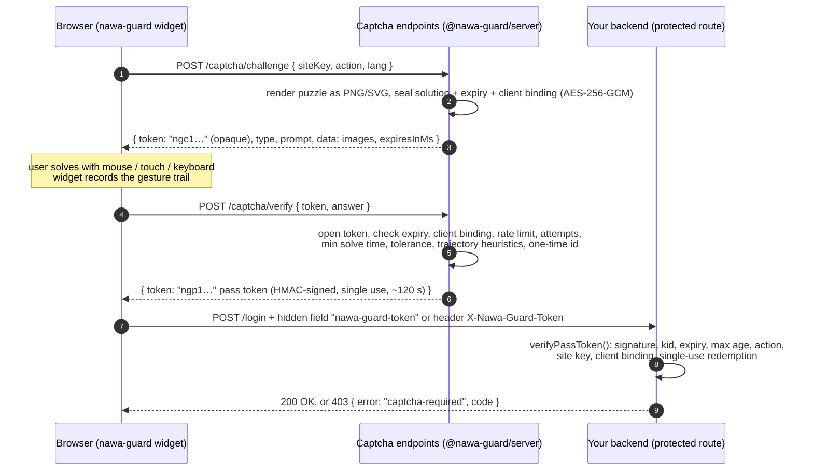

# Nawa Guard

[](https://github.com/oriebalzyuot96/nawa-guard/actions/workflows/ci.yml) [](LICENSE)

**Self-hosted, accessible puzzle CAPTCHA — an open-source reCAPTCHA / hCaptcha / Turnstile alternative for React, Vue, Svelte, Angular and plain HTML, with Node.js and ASP.NET Core verification.** 🌐 [Website](https://oriebalzyuot96.github.io/nawa-guard/)

```bash
npm i @nawa-guard/server @nawa-guard/widget    # or: yarn add / pnpm add
```

**Nawa Guard** is an open-source, privacy-friendly puzzle CAPTCHA from the Nawa family (a separate project from the Nawa UI component library). It's designed around three ideas:

1. **The client is never trusted.** Puzzles are rendered on the server as pixels. The solution is sealed inside the challenge token with AES-256-GCM and never reaches the browser in a form it can read.
2. **Verification happens on your own backend, the way reCAPTCHA's siteverify does.** A solved puzzle produces a short-lived, single-use, HMAC-signed **pass token**. Your protected route verifies it locally with no third-party call. Node and ASP.NET Core implementations are included and interoperate.
3. **Everyone can pass it.** Every puzzle works with mouse, touch and keyboard. A text-only alternative works with screen readers (WCAG 1.1.1 and 2.1.1). Arabic and English are built in, with full RTL support.

| Package | What it is |
|---|---|
| [`@nawa-guard/server`](packages/server) | Node ≥ 18 core with zero runtime dependencies (only `node:crypto` and `node:zlib`). Handles challenges, verification, pass tokens, stores, HTTP and Express adapters. |
| [`@nawa-guard/widget`](packages/widget) | `<nawa-guard>` Web Component: Shadow DOM, no dependencies, works under a strict CSP. |
| [`@nawa-guard/react`](packages/react) | `<NawaGuard>` component plus a `useNawaGuard()` hook (React 18/19). |
| [`@nawa-guard/vue`](packages/vue) | Vue 3 component with `v-model` support. |
| [`@nawa-guard/svelte`](packages/svelte) | Svelte 5 component with a bindable `token`. |
| [`@nawa-guard/angular`](packages/angular) | Standalone component that is also a `ControlValueAccessor` and `Validator`, for reactive forms. |
| [`dotnet/`](dotnet) `NawaGuard.AspNetCore` | .NET 8 package with `INawaGuardVerifier`, `[RequireNawaGuard]`, `.RequireNawaGuard()` and `AddNawaGuard()`. |
| [`demo/`](demo) | Express demo with every puzzle type, a protected form and a protected JSON API. |

## Puzzle types

| Type | What the user does | Tolerance / rule | Min. solve time | Attempts |
|---|---|---|---|---|
| `slider` | Drags a jigsaw piece into its gap. The background and piece arrive as two PNGs. The gap's x position is the secret. Level ≥ 1 adds a decoy hole. | ±6 px (±5 at level ≥ 2), plus trajectory checks | 450 ms | 2 |
| `rotate` | Rotates a picture until it is upright. | ±12° (±9° at level ≥ 2), with wrap-around, plus trajectory checks | 500 ms | 2 |
| `icons` | Selects every cell showing the named icon in a 3×3 PNG grid. | Must match the exact set | 1200 ms | 1 |
| `math` | Types the result of a sum drawn as a noisy SVG made of jittered stroke glyphs (no `<text>`) with decoy digits. | Exact integer. Arabic-Indic digits are accepted | 1500 ms | 1 |
| `order` | Reorders 4–5 tiles by dot count or bar height. Tiles carry random IDs. | Must match the exact order | 1500 ms | 1 |
| `trace` | Connects numbered dots in order. Unnumbered decoys are present. | Each dot must be hit within 20 px in order. Path length must be ≤ 2.2 × the optimal path + 160 px | 900 ms | 2 |
| `pow` | Nothing: an invisible hashcash proof of work. The goal is SHA-256(`salt:nonce`) with `bits` leading zero bits. | Default 16 bits, plus 2 bits per level | none | 1 |
| `accessible` | Answers a plain-text logic question in Arabic or English, such as "Which day comes after Monday?" | Answer is normalized: case, diacritics, alef/ta-marbuta variants, Arabic-Indic digits, words or digits. Includes a silent PoW tax | 2000 ms | 2 |

All of the above can be overridden per type (`maxAttempts`, `minSolveMs`). The server chooses the type from an **adaptive ladder**: failures from the same client raise the level, which switches to harder pools and tightens tolerances. `assessRisk()` can add levels from your own signals.

---

## How it works



The captcha endpoints and the protected route can be the same Node app (as in the demo) or different services that share the secret, for example a Node sidecar plus an ASP.NET Core API.

---

## Quick start (Node + Express)

```bash
npm install @nawa-guard/server @nawa-guard/widget express
```

```js
import express from 'express';
import { createNawaGuard } from '@nawa-guard/server';
import { nawaGuardExpress, requireCaptcha } from '@nawa-guard/server/express';

const guard = createNawaGuard({
  secret: process.env.NAWA_GUARD_SECRET, // ≥ 32 chars, from your secret store; never sent to browsers
  siteKeys: ['main'],                     // public identifiers the widget may use
  actions: ['login', 'signup', 'contact'],
});

const app = express();
app.set('trust proxy', 1); // only if you are behind a reverse proxy, so req.ip is the browser's IP

// 1) Challenge + verify endpoints → POST /captcha/challenge, POST /captcha/verify
app.use('/captcha', express.json({ limit: '32kb' }), nawaGuardExpress(guard));

// 2) Protect routes. The token comes from the X-Nawa-Guard-Token header or the nawa-guard-token field.
app.post('/login',
  express.urlencoded({ extended: false }),
  requireCaptcha(guard, { expectedAction: 'login', maxAgeSec: 300 }),
  (req, res) => res.send(`ok, solved with ${req.nawaGuard.typ}`));
```

Generate a secret once with `node -e "console.log(require('crypto').randomBytes(32).toString('base64url'))"`.

---

## Frontend integration

### Plain HTML / any framework (Web Component)

```html
<script type="module">import '@nawa-guard/widget';</script>

<form method="post" action="/login">
  <input name="email" type="email" required>
  <nawa-guard site-key="main" endpoint="/captcha" action="login" lang="ar"></nawa-guard>
  <button>Sign in</button>
</form>
```

| Attribute | Default | Meaning |
|---|---|---|
| `site-key` | `default` | Public site key. Never the secret. |
| `endpoint` | `/captcha` | Base URL of the two endpoints. |
| `action` | `default` | Action name. The backend must expect the same action. |
| `lang` | inherited `lang`, else `en` | `ar` or `en`. Arabic switches the widget to RTL. |
| `name` | `nawa-guard-token` | Name of the hidden `<input>` (in light DOM) that is submitted with the form. |
| `type` | (server decides) | Requested puzzle. Only honoured with `allowClientType: true`, except `accessible`, which is always allowed. |
| `dir` | from `lang` | Forces `rtl` or `ltr`. |

Events, all `bubbles` + `composed`:
- `nawa-guard:verified` with `detail: { token, expiresInMs, type }`
- `nawa-guard:expired` (the pass token lapsed and a new challenge loads)
- `nawa-guard:error` with `detail: { error: 'network' | 'rate-limited' | 'config' }`

API: `el.token` (`''` until verified) and `el.reset()`. Call `reset()` after you use a token, because tokens are single-use.

```js
const guard = document.querySelector('nawa-guard');
guard.addEventListener('nawa-guard:verified', (e) => submitBtn.disabled = false);
await fetch('/api/contact', { method: 'POST', headers: { 'X-Nawa-Guard-Token': guard.token, 'Content-Type': 'application/json' }, body });
guard.reset();
```

### React

```tsx
import { NawaGuard, useNawaGuard } from '@nawa-guard/react';

export function LoginForm() {
  const guard = useNawaGuard();
  async function onSubmit(e: React.FormEvent) {
    e.preventDefault();
    await fetch('/api/login', { method: 'POST', headers: { 'X-Nawa-Guard-Token': guard.token } });
    guard.reset(); // single-use
  }
  return (
    <form onSubmit={onSubmit}>
      <NawaGuard siteKey="main" action="login" lang="ar" {...guard.bind} />
      <button disabled={!guard.verified}>Sign in</button>
    </form>
  );
}
```

`<NawaGuard>` also accepts `onVerify(token, detail)`, `onExpire()`, `onError(detail)` and a `ref` (`{ reset(), token }`).

### Vue 3

```vue
<script setup lang="ts">
import { ref } from 'vue';
import { NawaGuard } from '@nawa-guard/vue';
const token = ref('');
</script>

<template>
  <NawaGuard v-model="token" site-key="main" action="login" lang="ar" @error="(d) => console.warn(d)" />
  <button :disabled="!token">Sign in</button>
  <!-- setting token.value = '' after a submit loads a fresh challenge -->
</template>
```

### Svelte 5

```svelte
<script lang="ts">
  import { NawaGuard } from '@nawa-guard/svelte';
  let token = $state('');
  let guard: ReturnType<typeof NawaGuard>;
</script>

<NawaGuard bind:this={guard} bind:token siteKey="main" action="login" lang="ar" />
<button disabled={!token} onclick={() => fetch('/api/login', { method: 'POST', headers: { 'X-Nawa-Guard-Token': token } }).finally(() => guard.reset())}>
  Sign in
</button>
```

### Angular (standalone + reactive forms)

```ts
import { Component, inject } from '@angular/core';
import { FormBuilder, ReactiveFormsModule, Validators } from '@angular/forms';
import { HttpClient } from '@angular/common/http';
import { NawaGuardComponent } from '@nawa-guard/angular';

@Component({
  selector: 'app-login',
  imports: [ReactiveFormsModule, NawaGuardComponent],
  template: `
    <form [formGroup]="form" (ngSubmit)="submit()">
      <input formControlName="email" type="email" />
      <nawa-guard-captcha formControlName="captcha" siteKey="main" action="login" lang="ar" />
      <button [disabled]="form.invalid">Sign in</button>
    </form>`,
})
export class LoginComponent {
  private http = inject(HttpClient);
  form = inject(FormBuilder).nonNullable.group({ email: ['', [Validators.required, Validators.email]], captcha: [''] });

  submit() {
    const { email, captcha } = this.form.getRawValue();
    this.http.post('/api/login', { email }, { headers: { 'X-Nawa-Guard-Token': captcha } })
      .subscribe({ complete: () => this.form.controls.captcha.reset() }); // reset → fresh challenge
  }
}
```

The control value is the pass token. The control reports `{ nawaGuard: true }` until the user is verified. `setDisabledState` makes the widget inert. Outputs: `(verified)`, `(expired)`, `(failed)`.

### Theming (Nawa UI tokens)

The widget reads the Nawa UI design tokens through the shadow boundary, so it follows any Nawa UI theme (light, dark or high-contrast) automatically. Each value resolves in this order: `--nawa-guard-*` (widget-specific override), then `--nw-*` (Nawa UI token), then a neutral fallback.

| Purpose | Variables |
|---|---|
| Brand | `--nw-primary`, `--nw-primary-hover`, `--nw-primary-soft`, `--nw-on-primary` |
| Surfaces | `--nw-surface`, `--nw-surface-alt` |
| Text | `--nw-text`, `--nw-text-muted` |
| Lines | `--nw-border`, `--nw-control-border`, `--nw-focus` |
| Status | `--nw-success`, `--nw-success-soft`, `--nw-danger`, `--nw-danger-soft` |
| Shape / type | `--nw-radius`, `--nw-radius-sm`, `--nw-font`, `--nw-ease`, `--nw-shadow-sm` |

The outer box is exposed as `::part(container)`. The widget honours `prefers-reduced-motion` and `forced-colors`. Styles use constructable stylesheets and CSSOM, so it runs under `style-src 'self'` with no `'unsafe-inline'`. The demo ships a strict CSP.

---

## Backend validation

### Node / Express

`requireCaptcha(guard, opts)` is shown above. The standalone function needs only the secret:

```js
import { verifyPassToken } from '@nawa-guard/server';

const result = await verifyPassToken(req.get('x-nawa-guard-token'), {
  secret: process.env.NAWA_GUARD_SECRET,     // or [{ kid, secret }, …] during rotation
  expectedAction: 'login',                   // required; tokens are not interchangeable across actions
  maxAgeSec: 120,
  client: { ip: req.ip, userAgent: req.get('user-agent') }, // required for bound tokens
  store,                                     // shared store for single use (default: in-process)
  // expectedSiteKey: 'main', allowedTypes: ['slider', 'icons', 'trace', 'accessible']
});
if (!result.ok) return res.status(403).json({ error: result.error });
// result.claims = { jti, sk, act, typ, lvl, iat, exp, cbm, cb }
```

Error codes: `missing-token`, `malformed`, `unknown-key`, `bad-signature`, `expired`, `not-yet-valid`, `too-old`, `action-mismatch`, `site-mismatch`, `type-not-allowed`, `client-mismatch`, `replayed`.

The framework-agnostic handlers are `handleChallenge(guard, { body, client })` and `handleVerify(guard, { body, client })`. They return `{ status, headers, body }`, so you can mount them in Fastify, Hono, Koa, Next route handlers and similar. `checkPassToken(guard, { headers, body, client }, opts)` covers protected routes.

### ASP.NET Core (.NET 8)

```csharp
// Program.cs
builder.Services.AddNawaGuard(builder.Configuration.GetSection("NawaGuard"));
// appsettings / user-secrets / env:  NawaGuard__Secret=<same secret as the Node server>
//                                    NawaGuard__ExpectedSiteKey=main, NawaGuard__MaxAgeSeconds=300

var app = builder.Build();
app.UseForwardedHeaders(); // if behind a proxy: RemoteIpAddress must be the browser's IP

// Minimal API
app.MapPost("/api/contact", (ContactDto dto) => Results.Ok()).RequireNawaGuard("contact");

// Controllers
[HttpPost("login"), RequireNawaGuard("login")]
public IActionResult Login(LoginDto dto) => Ok();

// Manual
public async Task<IActionResult> Signup([FromServices] INawaGuardVerifier guard, SignupDto dto)
{
    var result = await guard.VerifyAsync(HttpContext, "signup");
    if (!result.Success) return Problem(statusCode: 403, title: result.Error.ToCode());
    …
}
```

The filters read the token from `X-Nawa-Guard-Token` or from the `nawa-guard-token` form field. They don't read JSON bodies, so send the header for JSON APIs. Rejections are `403` `ProblemDetails` with `extensions.code` set to one of the error codes above. On success the claims are in `HttpContext.Items[NawaGuardVerifier.HttpContextItemKey]`.

**Single use across instances:** the default `InMemoryReplayStore` works for one instance only. Behind a load balancer, register a shared one before `AddNawaGuard`:

```csharp
// StackExchange.Redis
services.AddSingleton<INawaGuardReplayStore>(sp => new DelegateReplayStore((key, ttl, _) =>
    sp.GetRequiredService<IConnectionMultiplexer>().GetDatabase().StringSetAsync(key, "1", ttl, When.NotExists)));
```

### Token format (interop contract)

Both implementations must agree exactly on the following. The .NET tests verify tokens generated by the Node code (`npm run fixture:dotnet`).

```
Key derivation (RFC 5869 HKDF-SHA256, 32-byte output):
  K_chal = HKDF(ikm = UTF8(secret), salt = UTF8("nawa-guard/v1"), info = UTF8("challenge-token"))
  K_pass = HKDF(…, info = UTF8("pass-token"))
  K_bind = HKDF(…, info = UTF8("client-binding"))

kid: 1-16 chars [A-Za-z0-9_-]. The first configured secret signs; every configured secret verifies.
b64url = base64url without padding.

Challenge token (Node only, opaque to everyone else):
  "ngc1." kid "." b64url(iv[12]) "." b64url(AES-256-GCM(K_chal, iv, JSON claims, AAD = "ngc1." kid) || tag[16])
  claims: { v:1, id, typ, sk, act, lang, iat(ms), exp(ms), lvl, cbm, cb?, sol }

Pass token:
  payload = b64url(UTF8(JSON claims))
  sig     = b64url(HMAC-SHA256(K_pass, ASCII("ngp1." kid "." payload)))
  token   = "ngp1." kid "." payload "." sig
  claims: { v:1, jti (b64url 16 random bytes), sk (site key), act (action), typ (challenge type),
            lvl (difficulty level), iat (unix s), exp (unix s), cbm ("none"|"ip"|"ua"|"ip+ua"), cb? }

Client binding (cb = b64url(HMAC-SHA256(K_bind, material))):
  ip    = trim, lower-case, strip "::ffff:" prefix from IPv4-mapped addresses
  ua    = trim, first 512 UTF-16 code units
  material: ip → "ip=" ip ; ua → "ua=" ua ; ip+ua → "ip=" ip "\n" "ua=" ua
  If the material is unavailable at issue time the token is issued with cbm = "none".

Verification order: format → kid → constant-time signature check (before parsing JSON) → claims shape
  → iat ≤ now + skew → now < exp → now − iat ≤ maxAge → action → site key → type → binding → redeem jti once.
```

---

## Server options

```ts
createNawaGuard({
  secret,                       // string | { kid, secret }[]   (first entry signs)
  siteKeys, actions,            // allow-lists (recommended)
  store,                        // NawaGuardStore: MemoryStore (default), ioredisStore(client), nodeRedisStore(client)
  challengeTtlSec: 120, passTtlSec: 120,
  bind: 'ip+ua',                // 'none' | 'ip' | 'ua' | 'ip+ua'
  types,                        // enabled challenge types (default: all)
  ladder: [['slider','rotate'], ['icons','order','trace','slider'], ['icons','trace','math','order']],
  invisibleFirst: false,        // true → level 0 is an invisible 'pow'; visible puzzles appear after failures
  powBits: 16,                  // +2 bits per level, max 26
  allowClientType: false,       // demo/gallery only
  maxAttempts: { slider: 3 }, minSolveMs: { icons: 1500 },
  rateLimit: { windowSec: 60, challenge: 30, verify: 60 } | false | ((ctx) => boolean | Promise<boolean>),
  adaptive: { windowSec: 900, failuresPerLevel: 2, maxLevel: 3 } | false,
  assessRisk: ({ client, action, clientKey }) => extraLevels,
  onEvent: (e) => log(e),       // challenge-issued, verify-success, verify-failed (with internal reason), rate-limited
  defaultLang: 'en',
});
```

The store interface has two atomic primitives (`setIfAbsent`, `increment`) plus `count` and `delete`. Redis adapters use `SET NX PX` and an `INCR` + `PEXPIRE` Lua script. Counters are keyed by a pseudonymous HMAC of the client IP; raw IPs are never stored.

---

## Security model

**Why the client is never trusted.** The browser only ever gets pixels (PNG, or a noisy SVG of stroke paths for `math`) plus an opaque token. Positions, angles, the matching cells, the correct order, dot coordinates and accepted answers all live inside the AES-256-GCM-sealed challenge token. GCM's tag also makes the token tamper-evident: changing a single byte, swapping the kid or reusing another site's token fails to decrypt. All checks run on the server. The widget never decides anything.

**Stateless, but not replayable.** Challenges carry their own expiry (`exp`), issue time, client binding, level and solution, so the server stores no puzzle state. The only state is small: one-time IDs (`used:<id>`, `pass:<jti>`), attempt counters and rate-limit counters, all with TTLs. Redemption uses `setIfAbsent`, so of two concurrent correct submissions exactly one wins (this is tested).

**Pass tokens** are signed (HMAC-SHA256 with a purpose-specific HKDF key) and short-lived (120 s by default, with an extra `maxAgeSec`). They are **single-use** and scoped to an **action** and **site key**. They can be **bound to the client's IP and/or User-Agent**, so a token solved by a human click farm can't simply be replayed from a bot's IP. Every comparison of secrets or MACs is constant-time (`timingSafeEqual` / `CryptographicOperations.FixedTimeEquals`), and the signature is checked before any JSON is parsed.

**Expiry and attempts.** A challenge expires after `challengeTtlSec`. Each challenge allows a small, per-type number of attempts and is then burned. Answers faster than a human could produce them (`minSolveMs`, measured server-side from the sealed `iat`) count as failures.

**Rate limits and adaptive difficulty.** Challenge and verify calls are rate-limited per client. You can plug in your own limiter via a hook. Failures raise the client's level, which moves it to harder puzzle pools, tighter tolerances, more tiles, decoys and more PoW bits. `assessRisk` lets you add levels, for example after failed passwords for an account.

**No oracle for bots.** The browser only learns `failed`, `expired`, `invalid-token`, `invalid-input` or `rate-limited`. The precise reason (`too-fast`, `bot-suspected:constant-velocity`, `client-mismatch`, …) only goes to your `onEvent` logger.

**Secret rotation with key IDs.** Configure `[{ kid: 'k2', secret: new }, { kid: 'k1', secret: old }]`. New tokens are issued under `k2`, and outstanding `k1` tokens keep verifying. Remove `k1` after `max(challengeTtlSec, passTtlSec)`. The secret is dedicated to Nawa Guard and is never derived from your JWT key. Purpose-separated HKDF subkeys mean a challenge key can't sign a pass token.

**Input validation.** Every endpoint validates shape, type, size and range: token length ≤ 8 KB, trails ≤ 800 points with finite numbers and monotonic time, enumerated types and actions, bounded strings, and a 32 KB body limit in the Express adapter. Responses are `Cache-Control: no-store` and `nosniff`. There is no `eval` and no `innerHTML` with server data. The widget only accepts `data:image/png|svg+xml;base64` images, and SVGs are displayed through `` so they can't run script.

**What the heuristics can and can't stop.** The pointer-trajectory checks look at sample count, duration, timing regularity, speed variation and entropy, off-axis wobble and the heading noise of freehand strokes. They also check that the trail's travel agrees with the submitted answer. They reliably reject cheap automation: synthetic straight-line, constant-speed or instant drags. In the demo, a scripted browser-automation drag was rejected as `too-few-samples`. They **can't** stop a determined attacker who replays recorded human trajectories, uses computer vision to find the gap or angle, or pays a human solving service. Keyboard input is deliberately judged leniently for accessibility, which also gives bots a weaker path. Treat Nawa Guard as **cost-raising friction**, layered with rate limits, account lockout, `assessRisk` and monitoring of `onEvent` solve rates. No CAPTCHA, including this one, is proof of humanity.

**Type-specific strength.** `slider`, `rotate`, `icons`, `trace` and `order` are moderate (raster images, decoys, random styling). `math` is low assurance (OCR-able). `pow` proves CPU spent, not humanity. `accessible` is machine-readable by design, so it carries a PoW tax and is visible in the pass token (`typ`). Sensitive routes can restrict `allowedTypes`, or ask for a second factor when `typ` is `accessible` or `pow`.

---

## Accessibility

- **WCAG 1.1.1 (non-text content):** visual puzzles have a text alternative, the **accessible challenge** (toolbar button with `aria-pressed`). It is a plain-language question in Arabic or English with no image or audio, answerable in words or digits. Image `alt` text points users to it.
- **WCAG 2.1.1 (keyboard):** every puzzle is fully operable without a pointer:
  - slider and rotate: `role="slider"` with arrows (Shift for big steps), Home/End, Enter to submit
  - icons: a grid of toggle buttons (`aria-pressed`) with arrow-key roving focus
  - order: Space to pick up, arrows to move (RTL-aware), Space to drop, with each move announced
  - trace: a crosshair moved with arrows, Space to add a point, Backspace to undo
  - math and accessible: ordinary text inputs
- **Status messages (4.1.3):** loading, wrong answer, expiry, success and reorder announcements go to a `role="status"` live region.
- **Visible focus (2.4.7):** a 3 px `--nw-focus` outline, with `Highlight` in forced-colors mode.
- **Target size:** controls are ≥ 44 px.
- **Motion:** honours `prefers-reduced-motion`.
- **RTL:** Arabic mirrors the layout and reading order. The image stages stay physically LTR so that "right" means right on the picture.
- **Timing:** challenges refresh themselves before expiry with an announcement, and pass tokens live long enough to finish a short form. Raise `passTtlSec` for longer forms.

---

## Integrate into mashroo3hub

mashroo3hub currently runs its own 3×3 "board" captcha. On the client that's `ui-recaptcha` plus `LoginCaptchaDialogComponent` and the `login-recoth` dialog. On the server it's `LoginCaptchaService`, `LoginCaptchaGate` and the `RequestLoginOtp` board branch. Nawa Guard maps onto it without breaking the onion rules, in five steps.

**1. Run the challenge service as a sidecar.** Challenge generation is Node-only, so add a tiny service and serve it under the same origin as the API at `/captcha`, through the reverse proxy and the Angular dev `proxy.conf`:

```js
// captcha/server.mjs  (docker-compose service "captcha", NAWA_GUARD_SECRET from the same secret store as the API)
import express from 'express';
import { createNawaGuard, nodeRedisStore } from '@nawa-guard/server';
import { nawaGuardExpress } from '@nawa-guard/server/express';
import { createClient } from 'redis';

const redis = await createClient({ url: process.env.REDIS_URL }).connect();
const guard = createNawaGuard({
  secret: process.env.NAWA_GUARD_SECRET,
  siteKeys: ['mashroo3hub-web'],
  actions: ['login', 'login-otp', 'password-reset', 'social'],   // = LoginCaptchaPurpose
  bind: 'ip',                       // the API sees the same client IP through the proxy
  store: nodeRedisStore(redis),     // the Redis mashroo3hub already runs
});
const app = express();
app.set('trust proxy', 1);
app.use('/captcha', express.json({ limit: '32kb' }), nawaGuardExpress(guard));
app.listen(8080);
```

**2. Update the Angular login dialogs.** Replace `<ui-recaptcha>` inside `login-captcha-dialog.component.html` (and the `login-recoth` one) with the wrapper. Map the dialog's `purpose` to the action:

```ts
// login-captcha-dialog.component.ts
imports: [..., NawaGuardComponent],
protected readonly action = computed(() => ({ otp: 'login-otp', password: 'login', reset: 'password-reset', social: 'social' })[this.purpose()]);
protected readonly captcha = new FormControl('', { nonNullable: true });
// template:
// <nawa-guard-captcha [formControl]="captcha" siteKey="mashroo3hub-web" [action]="action()" [lang]="i18n.lang()"
//                     (verified)="confirmed.emit({ token: $event.token })" />
```

`LoginCaptchaProof` becomes `{ token: string }`. In `AuthApiService.wireCaptcha()`, send `captchaToken` only and drop `captchaKind`/`captchaMove`, or set an `X-Nawa-Guard-Token` header from an interceptor. The local `createCaptchaPuzzle` fallback, the `chooseGame` picker and `isCorrectCaptchaMove` are no longer needed. On `CP0003`/`CP0001`, call `this.captcha.reset()` to get a fresh challenge. This replaces `captchaReload`.

**3. Update the .NET API while keeping the onion layering.** Application keeps owning the abstraction, and Infrastructure implements it with `NawaGuard.AspNetCore`:

```csharp
// mashroo3hub.Application/Common/Interfaces/IHumanCheck.cs
public interface IHumanCheck
{
    Task<CaptchaVerifyStatus> VerifyAsync(string? passToken, string action, string? clientIp, string? userAgent);
}

// mashroo3hub.Infrastructure/Notifications/NawaGuardHumanCheck.cs
public sealed class NawaGuardHumanCheck(INawaGuardVerifier verifier) : IHumanCheck
{
    public async Task<CaptchaVerifyStatus> VerifyAsync(string? token, string action, string? ip, string? ua)
    {
        var r = await verifier.VerifyAsync(token, action, new NawaGuardClient(ip, ua));
        return r.Success ? CaptchaVerifyStatus.Success
             : r.Error is NawaGuardError.Expired or NawaGuardError.Replayed or NawaGuardError.MissingToken ? CaptchaVerifyStatus.Expired
             : CaptchaVerifyStatus.Invalid;
    }
}

// mashroo3hub.Infrastructure/Common/DependencyInjection.cs
services.AddSingleton<INawaGuardReplayStore>(sp => new DelegateReplayStore(async (key, ttl, _) =>
    await sp.GetRequiredService<ICacheManager>().Increment(key, ttl) == 1));   // INCR is atomic
services.AddNawaGuard(configuration.GetSection("NawaGuard"));
services.AddScoped<IHumanCheck, NawaGuardHumanCheck>();
```

In `LoginCaptchaGate.EnsureAsync`, replace `captcha.VerifyAsync(token, wire, move, clientKey)` with `humanCheck.VerifyAsync(token, action, clientKey, userAgent)`. Keep the existing behaviour around it: an empty token with an `allowResendGrant` grant still passes, `CP0002` is returned when the token is missing, and the existing `CP0001`/`CP0003` mapping stays. `UsersController` already sets `ClientKey` from `RemoteIpAddress`. Add `UserAgent` the same way if you choose `bind: 'ip+ua'`, and call `app.UseForwardedHeaders()` when running behind the proxy. The board-issuing branch of `RequestLoginOtp` (`IsBoardRequest`) and `CaptchaKind`/`CaptchaMove` are no longer needed. `GrantResendAsync` and `GrantSocialAsync` can stay as they are: they are server-side grants issued *after* a successful check.

**4. Configuration.** Set `NawaGuard__Secret` (API) and `NAWA_GUARD_SECRET` (sidecar) to the same value. Use a new secret, not `JWT:JwtSigningKey`. Optionally set `NawaGuard__ExpectedSiteKey=mashroo3hub-web`, and `NawaGuard__AllowedTypes` to exclude `pow` for password reset.

**5. Mobile (Expo).** The Web Component needs a DOM. In React Native, host it in a `WebView` page served from `/captcha/widget`, or build a native screen for the `accessible` + `pow` types against the same two endpoints.

---

## Development

```bash
npm install
npm run build        # server, widget, react, vue (tsc) + angular (ng-packagr, partial Ivy)
npm run typecheck    # every package (svelte via svelte-check) + test files
npm test             # Vitest
npm run test:dotnet  # xUnit (requires .NET 8 SDK/runtime)
npm run demo         # http://localhost:5180
npm run fixture:dotnet  # regenerate the Node→.NET interop fixture
```

The demo serves the gallery (all eight types, with a language toggle and a dark theme), a protected HTML form (`requireCaptcha`, hidden field) and a protected JSON API (header). It runs under a strict CSP. Set `NAWA_GUARD_SECRET` to keep tokens valid across restarts.

## Background: what earlier implementations taught us

Nawa Guard comes from two in-house captchas (mashroo3hub, and a similar one in the Dada project). Kept from them: server-issued boards, take-before-check single redemption ("timeout-or-duplicate"), IP binding, a minimum solve time, issue-rate limiting and logging of suspicious solves (now the `onEvent` hook). Fixed:

- **The solution was computable from the payload.** Boards were sent as data (`cells`, `values`, `target`). An odd-one-out, biggest or arrow-odd answer is one line of script, and screen-reader labels named every shape. Nawa Guard sends only rendered pixels.
- **The client picked the game,** so an attacker could always choose the easiest one. Here the server chooses through the adaptive ladder.
- **A blind guess passed about 11% of the time** (9 cells, one tap). Here the answer spaces are continuous or combinatorial, with tolerances, attempt caps and trajectory checks.
- **The sealing key was derived from the JWT signing key.** Nawa Guard uses a dedicated secret, purpose-separated HKDF keys and kid rotation.
- **Puzzle logic lived on the client** (a local generator, `isCorrectCaptchaMove`). Here the client has no puzzle logic at all.
- **Every board required server state.** Here challenges are stateless sealed tokens, and only one-time IDs and counters are stored.
- **There was no non-visual alternative and no interaction analysis.** Both are added.

## العربية: ملخص

**Nawa Guard (نوى غارد)** مكتبة CAPTCHA مفتوحة المصدر من عائلة «نوى»، منفصلة عن مكتبة Nawa UI. تعرض ألغازًا يولّدها الخادم صورًا: سحب قطعة اللغز إلى مكانها، وتدوير الصورة حتى تعتدل، واختيار الأشكال المطابقة، وعملية حسابية مرسومة، وترتيب البطاقات، وتوصيل النقاط. وفيها إثبات عمل غير مرئي، وتحدٍّ نصي ميسّر لمستخدمي قارئات الشاشة.

- **لا ثقة بالمتصفح:** الحل مختوم داخل الرمز بتشفير AES-256-GCM ولا يصل إلى العميل أبدًا، وكل التحقق يجري على الخادم.
- **رمز عبور (Pass token)** موقّع بـ HMAC، قصير العمر، يُستخدم مرة واحدة فقط، ومقيّد بالإجراء (مثل `login`) ويمكن ربطه بعنوان IP والمتصفح. يتحقق منه الخادم الخلفي محليًا عبر `verifyPassToken` في Node أو `INawaGuardVerifier` و`[RequireNawaGuard]` في ASP.NET Core. التنسيق موثّق ومتوافق بين المنصتين ومختبر بينهما.
- **حماية إضافية:** تحديد المعدل، وصعوبة تتكيف بعد الإخفاقات، وحد للمحاولات، وحد أدنى لزمن الحل، وتحليل حركة المؤشر لرفض السحب الآلي المستقيم، وتدوير المفاتيح عبر معرّف `kid`.
- **إتاحة كاملة:** كل لغز يعمل بالفأرة واللمس ولوحة المفاتيح، ويدعم العربية والإنجليزية مع اتجاه RTL، ويتبع رموز تصميم Nawa UI (`--nw-*`) ويحترم تقليل الحركة ووضع الألوان القسرية.
- **التكامل:** مكوّن ويب `<nawa-guard>` مع أغلفة React وVue وSvelte وAngular (مع ControlValueAccessor للنماذج التفاعلية). يشرح قسم «Integrate into mashroo3hub» أعلاه خطوات دمجه في نافذة تسجيل الدخول وفي نقاط .NET الحالية.
- **حدود صريحة:** الكابتشا تزيد كلفة الهجوم ولا تمنعه نهائيًا. المهاجم المصمم قد يستخدم الرؤية الحاسوبية أو حلّالين بشريين، لذلك اجمعها مع تحديد المعدل وقفل الحسابات والمراقبة.

## License

MIT. See [LICENSE](LICENSE).
